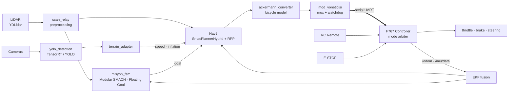

<div align="center">

# LYDİA UGV — Autonomous Driving Stack

Full autonomous driving software stack running on an Ackermann steering vehicle,
developed for the TEKNOFEST Unmanned Ground Vehicle (UGV) Competition.

[](https://github.com/yagizcngz/teknofest-ika-lydia/actions/workflows/testler.yml)
[](LICENSE)
[](https://docs.ros.org/en/humble/)
[](#)
[](config/nav2_params.yaml)
[](test_birim.py)

</div>

Finished **12th among 30 teams** (207.62 points) in the TEKNOFEST 2026 Unmanned Ground Vehicle competition. Only the top 14 teams that completed the manual run qualified for the autonomous track; LYDİA was one of those 14 vehicles.

The system comprises **23 ROS 2 nodes** running on an NVIDIA Jetson Orin Nano: LiDAR and vision perception, sensor fusion, Nav2-based navigation, mission finite state machine (SMACH FSM), safety watchdogs, and a serial bridge communicating with the vehicle motor controller board. All 11 track stages are navigated autonomously, each tailored with distinct terrain profiles and time budgets.

> The vehicle's **motor controller board firmware is not included in this repository**; the hardware controller layer was maintained separately ([dwifk0/IKA-MAGNESIA-LYDIA](https://github.com/dwifk0/IKA-MAGNESIA-LYDIA)). This repository contains the decision-making, perception, navigation, and safety stack running on the onboard Jetson computer.

---

## System Architecture



The Jetson computer never sends raw actuation signals directly to actuators: every command passes through the hardware controller board's mode arbitration logic, where RC remote control always retains override authority. If the onboard computer crashes or fails, manual remote control remains operational.

---

## Key Engineering Decisions

### Mapless Floating Goal Driving
The vehicle navigates the track without relying on static SLAM maps or hardcoded waypoint coordinates. In `kayan` (floating) mode, local goals are dynamically extracted from the corridor center line via real-time LiDAR scans. A stage finishes not by reaching a coordinate, but by traversing the measured track segment distance (`mesafe_m`). Distances were measured directly from the official competition CAD model.

Consequently, map distortion, localization drift, or TF coordinate shifts do not stall the mission. See [`docs/GOREV.md`](docs/GOREV.md).

### Modular Finite State Machine (SMACH FSM)
To maintain code readability and simplify testing, the mission state machine was refactored into modular, decoupled state classes (`fsm/states/`: `IdleState`, `NavigateState`, `RampaState`, `HizlanmaState`, `ShootState`, `ErrorRecoveryState`, etc.) and dedicated helper modules (`fsm/helpers/`: `Nav2Client`, `MisyonSaati`, `KoridorIzleyici`).

### Anti-Rollback and Safety Watchdog
On steep incline segments (Track §6.10 ramp), if the Nav2 planner crashes or goal transmission stalls, an intentional reverse timeout (command watchdog) and an anti-rollback state machine detect backward roll and trigger the mechanical braking cycle within milliseconds.

### Asynchronous Thread-Safe Telemetry
To prevent live video encoding operations from blocking or dropping real-time telemetry updates and the mission control loop, an asynchronous threaded queue architecture was implemented.

### Custom Ackermann Behavior Trees
The default Nav2 behavior tree relies on `Spin` recovery actions, which crash `bt_navigator` on Ackermann steering platforms unable to perform in-place rotations. Custom behavior trees were designed without `Spin` nodes, utilizing `BackUp` recovery maneuvers instead. See [`config/bt/`](config/bt) and [`docs/NAV2.md`](docs/NAV2.md).

### Unit Test Suite
A test suite of **328+ unit tests** verifies kinematics transformations, FSM state transitions, protocol serialization (CRC/XOR), and timeout logic. The entire suite runs automatically via GitHub Actions CI in a ROS 2 Humble container on every push.

---

## Repository Structure

```
├── .github/workflows/      # Automated CI/CD test workflow
├── config/                 # Nav2, EKF, behavior trees, and waypoint configurations
│   ├── bt/                 # Spin-free Ackermann Nav2 behavior trees
│   ├── nav2_params.yaml    # SmacPlannerHybrid & Regulated Pure Pursuit parameters
│   └── waypoints.yaml      # 11 track stage profiles and distance configurations
├── docs/                   # Detailed subsystem documentation
│   ├── MIMARI.md           # System architecture and data flow
│   ├── DUGUMLER.md         # ROS 2 node contracts and topic interfaces
│   ├── GOREV.md            # Mission state machine and stage logic
│   ├── NAV2.md             # Navigation and costmap configuration details
│   └── KURULUM.md          # Setup and development guide
├── donanim/
│   └── PROTOKOL_F767.md    # Jetson <-> Controller board serial protocol contract
├── launch/                 # ROS 2 launch files
├── scripts/                # CAD analysis, validation, and dashboard utilities
├── teknofest_ika/          # Main ROS 2 package
│   ├── otonomi/            # FSM, kinematics, safety nodes, and pure logic
│   ├── gomulu/             # Serial communication bridge and packet parsers
│   └── gorsel/             # LiDAR and camera preprocessing nodes
├── test_birim.py           # 328+ unit test suite
└── urdf/                   # Vehicle robot model and sensor TF transforms
```

---

## Contributors

### Bugra Ozturk ([@bugraozturk012](https://github.com/bugraozturk012)) — Autonomous Driving Software
- Lead developer of the perception, sensor fusion, Nav2 navigation, and decision pipeline on Jetson.
- Initial architecture of the 23 ROS 2 nodes, YOLO/TensorRT traffic sign detection, Nav2 tuning, and CAD track analysis tools (`scripts/parkur_cad`).

### Ahmet Efe Nezli ([@dwifk0](https://github.com/dwifk0)) — Vehicle Electronics & Controller Board
- Nucleo-F767ZI firmware architecture, power distribution, emergency stop (E-STOP) circuitry, and Jetson <-> board serial protocol interface ([`donanim/PROTOKOL_F767.md`](donanim/PROTOKOL_F767.md)).
- Platform-independent firmware core: [dwifk0/IKA-MAGNESIA-LYDIA](https://github.com/dwifk0/IKA-MAGNESIA-LYDIA).

### Yagiz Cengiz ([@yagizcngz](https://github.com/yagizcngz)) — FSM Refactoring, Safety & Telemetry
- Refactored the mission state machine (`misyon_fsm`) into a modular architecture (`states` / `helpers`) for improved testability and maintainability.
- Developed the Anti-Rollback 2.0 state machine and command watchdog for Nav2 crash recovery.
- Implemented asynchronous threaded queue architecture for video encoding telemetry and ROS 2 FastDDS unicast network isolation.
- Serial protocol CRC packet synchronization fixes and unit test development.

### Umit Akpinar ([@umitakpinarr](https://github.com/umitakpinarr))
- Turret mechanical and CAD design.

---

## License

This project is licensed under the **[Apache License 2.0](LICENSE)**. See [NOTICE](NOTICE) for detailed attributions.
